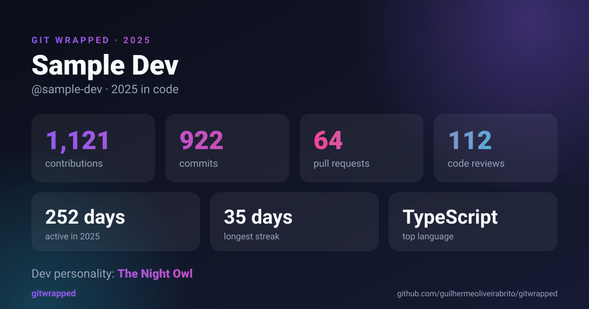
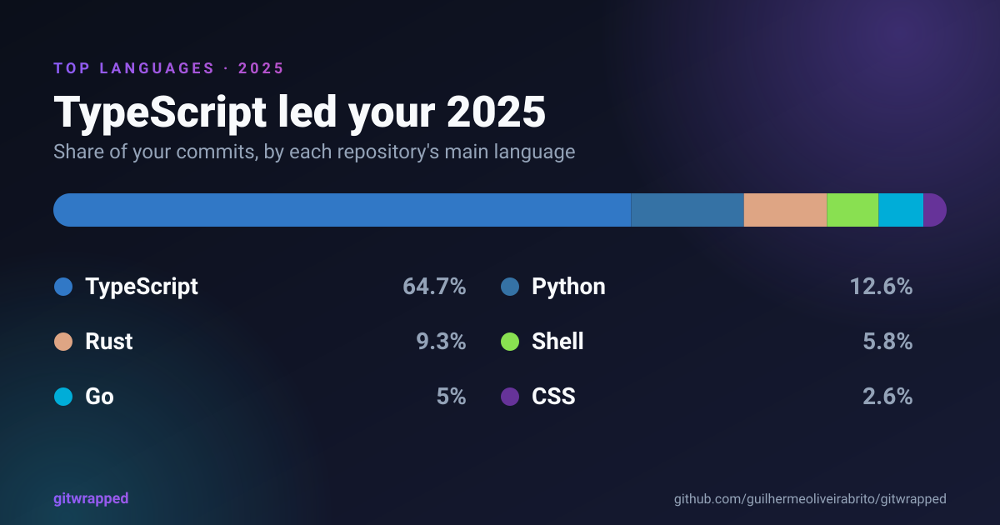
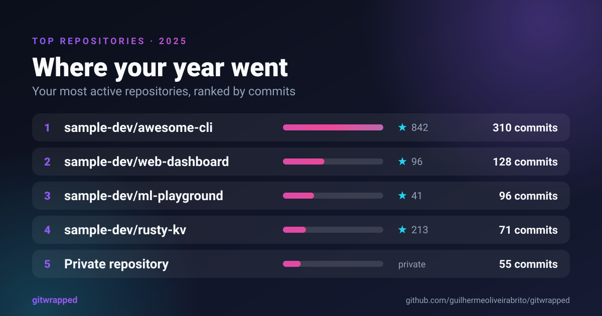
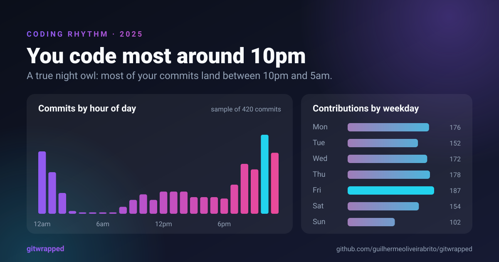
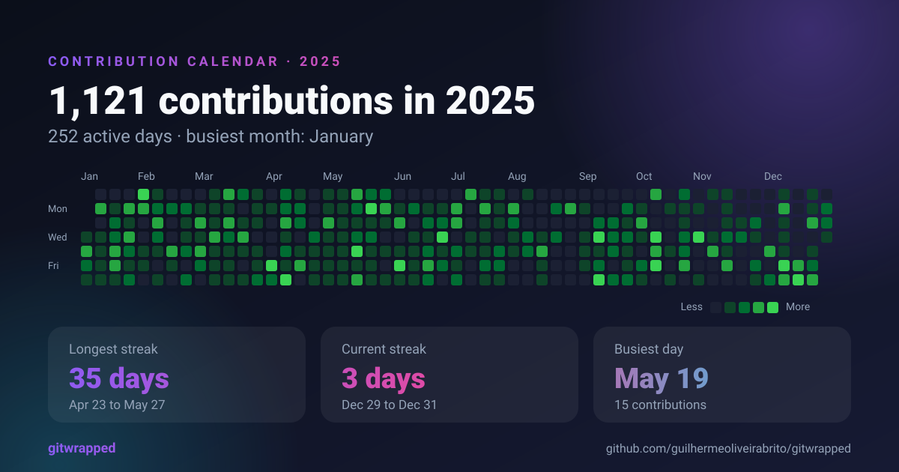
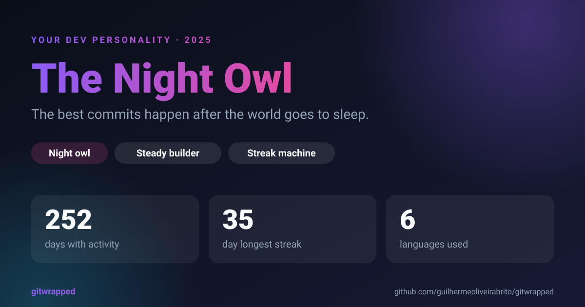
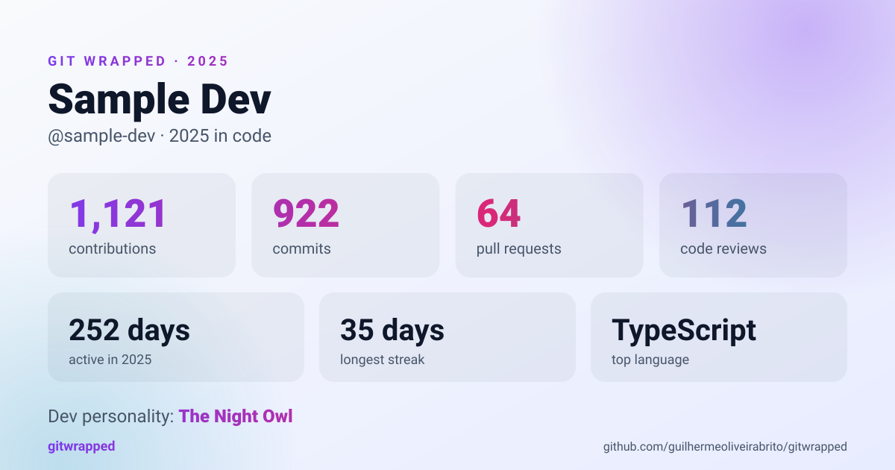

<div align="center">

# 🎁 Git Wrapped

**Your year in code, wrapped.**
Shareable recap cards for any GitHub profile: languages, streaks, coding rhythm and your dev personality.

[](https://github.com/guilhermeoliveirabrito/gitwrapped/actions/workflows/ci.yml)
[](LICENSE)
[](https://nodejs.org)
[](package.json)

[Português](README.pt-BR.md)



</div>

## Why

Spotify has Wrapped. Your commit history deserves one too. Git Wrapped turns a year of GitHub activity into a set of clean 1200×630 cards that are ready to post or embed in your profile README.

- **Six cards**: summary, languages, top repositories, coding rhythm, contribution calendar and dev personality
- **Dark and light themes**, plain SVG: sharp at any size, tiny, and works in a README
- **CLI and HTTP API**: generate files locally, or serve cards you can embed with one line of Markdown
- **Zero runtime dependencies**: just Node.js, the standard library and the GitHub GraphQL API
- **Private by default**: private repository names never appear on a card
- **Try it without a token**: `--demo` runs on built-in sample data

## Quick start

You need Node.js 22.18 or newer.

```bash
git clone https://github.com/guilhermeoliveirabrito/gitwrapped.git
cd gitwrapped
npm install

# no token needed, uses sample data
npm run cli -- --demo
```

To use your own profile, create a [personal access token](https://github.com/settings/tokens) (no scopes are needed for public data; add `read:user` to count private contributions) and run:

```bash
export GITHUB_TOKEN=ghp_your_token
npm run cli -- <your-username>
```

Cards are written to `./wrapped` and a summary is printed in the terminal:

```text
  Git Wrapped 2025 · @sample-dev

  1,121 contributions   922 commits   64 PRs   112 reviews
  252 days active · longest streak 35 days · current streak 3 days
  Busiest day: May 19 (15 contributions)
  Peak hour: 10pm (night coder)

  Languages
  TypeScript ████████████████░░░░░░░░ 64.7%
  Python     ███░░░░░░░░░░░░░░░░░░░░░ 12.6%
  Rust       ██░░░░░░░░░░░░░░░░░░░░░░ 9.3%
  ...

  🦉 The Night Owl
  The best commits happen after the world goes to sleep.
```

### CLI options

| Option | Description |
| --- | --- |
| `-y, --year <year>` | Year to summarize (default: current year) |
| `-c, --card <names>` | Comma separated cards, or `all` (default) |
| `-t, --theme <theme>` | `dark` (default), `light` or `both` (files get a `-dark` / `-light` suffix) |
| `-o, --out <dir>` | Output directory (default: `./wrapped`) |
| `--name <template>` | File name without extension, with `{login}`, `{year}` and `{card}` (default: `{login}-{year}-{card}`) |
| `--tz=<hours>` | UTC offset for the hourly chart, e.g. `--tz=-3` (default: your system timezone) |
| `--json` | Print the computed stats as JSON instead of writing files |
| `--demo` | Use built-in sample data, no token needed |

```bash
npm run cli -- octocat --year 2024 --card summary,heatmap --theme light
```

## The cards

| | |
| --- | --- |
|  |  |
|  |  |
|  |  |

Every card comes in a dark and a light theme (the last one above is the light summary).

## Keep your profile README up to date (GitHub Action)

The easiest way to show your cards on your GitHub profile needs no server. This repository is also a GitHub Action: it regenerates your cards on a schedule and commits them to your profile repository (the one named `<your-username>/<your-username>`).

Create `.github/workflows/gitwrapped.yml` there:

```yaml
name: Update Git Wrapped

on:
  schedule:
    - cron: "0 6 * * 1"   # every Monday
  workflow_dispatch:

permissions:
  contents: write

jobs:
  wrapped:
    runs-on: ubuntu-latest
    steps:
      - uses: actions/checkout@v4
      - uses: guilhermeoliveirabrito/gitwrapped@main
        with:
          tz: "-3"   # your UTC offset, used for the hours chart
```

Then reference the cards in your profile `README.md`. The `<picture>` element picks the dark or light card to match the viewer's GitHub theme:

```html
<picture>
  <source media="(prefers-color-scheme: dark)" srcset="gitwrapped/summary-dark.svg">
  <source media="(prefers-color-scheme: light)" srcset="gitwrapped/summary-light.svg">
  
</picture>
```

Run the workflow once by hand from the **Actions** tab to create the first set of cards. The file names never include the year, so the README does not need to change when the year does.

| Input | Default | Description |
| --- | --- | --- |
| `username` | repository owner | GitHub user to summarize |
| `token` | `github.token` | Token used to read GitHub data. The default only sees public activity; pass a personal access token with `read:user` to include private contributions |
| `year` | current year | Year to summarize |
| `cards` | all | Comma separated list of cards |
| `tz` | UTC | UTC offset in hours for the hourly chart, e.g. `-3` |
| `output-dir` | `gitwrapped` | Directory for the cards, relative to the repository root |
| `commit` | `true` | Commit and push when the cards changed |
| `commit-message` | `Update Git Wrapped cards` | Message of that commit |
| `demo` | `false` | Use sample data instead of calling GitHub |

The action also sets a `changed` output (`true`, `false` or `unknown`), so later steps can react to new cards.

## Embed with the HTTP server

If you would rather host the API yourself, run the server and every card becomes an image URL:

```bash
export GITHUB_TOKEN=ghp_your_token
npm start        # after npm run build, or use npm run dev
```

```markdown

```

Open the server's home page for a live preview and a copy-paste snippet. Because it is a regular image, it works anywhere Markdown does.

### API

| Endpoint | Returns |
| --- | --- |
| `GET /api/card/:card?user=&year=&theme=&tz=` | An SVG card |
| `GET /api/stats?user=&year=&tz=` | The computed stats as JSON |
| `GET /api/demo/:card?theme=` | A card with sample data, no token needed |
| `GET /healthz` | Health check |

`:card` is one of `summary`, `languages`, `repos`, `rhythm`, `heatmap`, `personality`. Errors on card endpoints are rendered as a card too, so a broken embed explains itself instead of showing a missing-image icon.

GitHub data is cached in memory for an hour, concurrent lookups for the same profile are de-duplicated, and each client is limited to 60 requests per minute. Set `TRUST_PROXY=1` when running behind a reverse proxy so the limit applies per real client address.

### Docker

```bash
docker build -t gitwrapped .
docker run -p 3000:3000 -e GITHUB_TOKEN=ghp_your_token gitwrapped
```

## Dev personalities

Your personality comes from simple, readable rules over your real activity. There is no model and no randomness: the same year always gives the same result.

| | Personality | Signal |
| --- | --- | --- |
| 🦉 | The Night Owl | Most commits land between 10pm and 5am |
| 🌅 | The Early Bird | Most commits land between 5am and noon |
| ⚔️ | The Weekend Warrior | 35%+ of contributions on weekends |
| 🏃 | The Marathoner | A streak of 21+ days |
| ⚡ | The Sprinter | Most of the year's work in the busiest 10% of days |
| 🤝 | The Collaborator | PRs, issues and reviews dominate |
| 🌍 | The Polyglot | Six or more languages |
| 🎯 | The Specialist | One language over 75% of commits |
| 🧱 | The Steady Builder | Active on more than half the days of the year |
| 🧭 | The Explorer | Everything else |

The rules live in [`src/personality.ts`](src/personality.ts). Want a new archetype? Open a PR.

## How it works

```text
GitHub GraphQL API
       │  fetchYearData()        src/github.ts
       ▼
   RawYearData ──► computeStats() ──► WrappedStats      src/stats.ts
                                          │
                          ┌───────────────┼───────────────┐
                          ▼               ▼               ▼
                      renderCard()       CLI          HTTP server
                       src/cards/     src/cli.ts     src/server.ts
```

- **One request, two sources.** The contribution calendar and per-repository commit counts come from a single GraphQL query. Commit timestamps for the hourly chart are sampled with a second, aliased query (up to 100 commits from each of your 10 most active repositories) because the calendar only has day-level precision. If that sample fails, the hourly chart is skipped and everything else still works.
- **Pure core.** `computeStats` has no I/O and takes the current time as a parameter, so the stats are easy to test.
- **No templating library.** Cards are plain SVG strings built with a tiny helper layer in `src/cards/svg.ts`, and every piece of user-controlled text is escaped.

## Development

```bash
npm install
npm test             # unit and integration tests (node:test)
npm run typecheck
npm run build        # compile to dist/
npm run examples     # regenerate docs/examples
```

Node runs the TypeScript sources directly during development, so there is no watch step and no bundler. Tests mock the GitHub API and also start a real HTTP server on an ephemeral port.

## Roadmap

Ideas that would make a great first contribution:

- [ ] Publish to npm so `npx gitwrapped <user>` just works
- [ ] Publish the Action to the GitHub Marketplace
- [ ] PNG export for platforms that do not accept SVG
- [ ] More cards: pull request and review stats, most starred repository
- [ ] Translated cards (the strings are all in `src/cards/`)
- [ ] Team and organization wrapped

See [CONTRIBUTING.md](CONTRIBUTING.md) to get started.

## License

[MIT](LICENSE) © Guilherme Oliveira de Brito Silva
