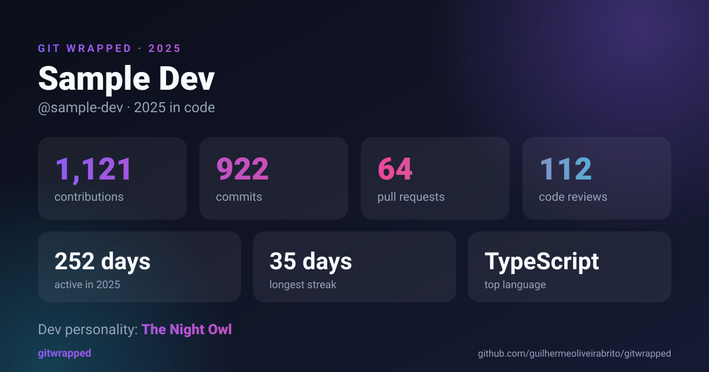

<div align="center">

# 🎁 Git Wrapped

**O seu ano em código, resumido.**
Cards compartilháveis para qualquer perfil do GitHub: linguagens, sequências, ritmo de código e a sua personalidade dev.

[English](README.md)



</div>

## O que é

O Spotify tem o Wrapped. O seu histórico de commits também merece um. O Git Wrapped transforma um ano de atividade no GitHub em cards 1200×630 prontos para postar ou colocar no README do seu perfil.

- **Cinco cards**: resumo, linguagens, ritmo de código, calendário de contribuições e personalidade dev
- **Temas escuro e claro**, em SVG puro: nítido em qualquer tamanho e funciona em README
- **CLI e API HTTP**: gere arquivos localmente ou rode um servidor e embuta os cards com uma linha de Markdown
- **Zero dependências em runtime**: só Node.js, a biblioteca padrão e a API GraphQL do GitHub
- **Privado por padrão**: nomes de repositórios privados nunca aparecem nos cards
- **Teste sem token**: `--demo` usa dados de exemplo embutidos

## Como usar

Precisa do Node.js 22.18 ou mais novo.

```bash
git clone https://github.com/guilhermeoliveirabrito/gitwrapped.git
cd gitwrapped
npm install

# sem token, com dados de exemplo
npm run cli -- --demo
```

Para usar o seu perfil, crie um [token de acesso pessoal](https://github.com/settings/tokens) (dados públicos não exigem nenhum escopo; adicione `read:user` para contar contribuições privadas):

```bash
export GITHUB_TOKEN=ghp_seu_token
npm run cli -- seu-usuario --tz=-3
```

Os cards são salvos em `./wrapped`. A opção `--tz` define o fuso usado no gráfico por hora (por padrão, o fuso do seu sistema).

## Embutir no README do perfil

Suba o servidor e cada card vira uma URL de imagem:

```bash
export GITHUB_TOKEN=ghp_seu_token
npm run build && npm start
```

```markdown

```

Também há um `Dockerfile` para hospedar por conta própria. Veja a seção de API e Docker no [README em inglês](README.md#embed-in-your-profile-readme).

## Contribuindo

Contribuições são bem-vindas, inclusive traduções dos cards. Leia o [CONTRIBUTING.md](CONTRIBUTING.md).

## Licença

[MIT](LICENSE) © Guilherme Oliveira de Brito Silva
